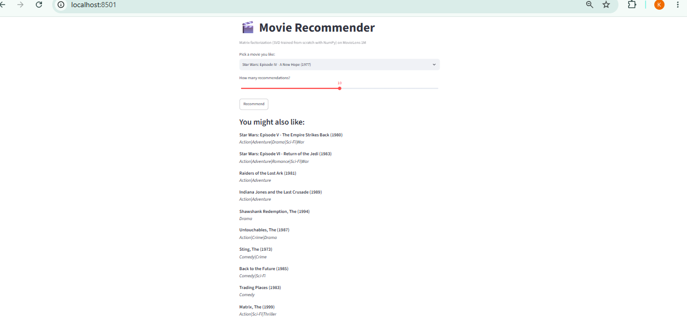
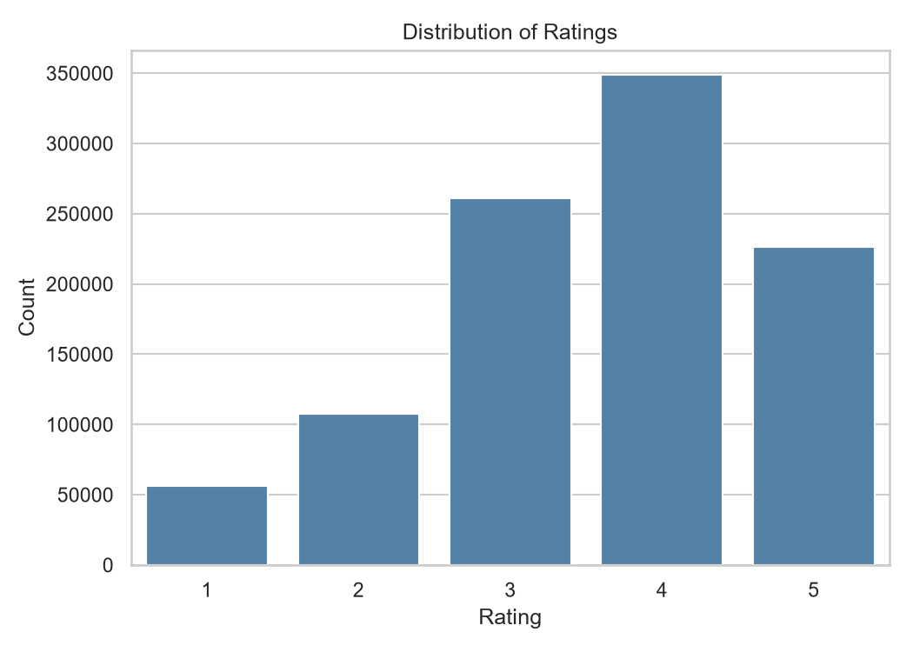
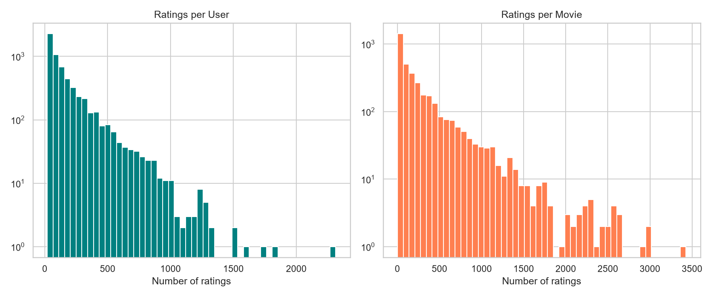
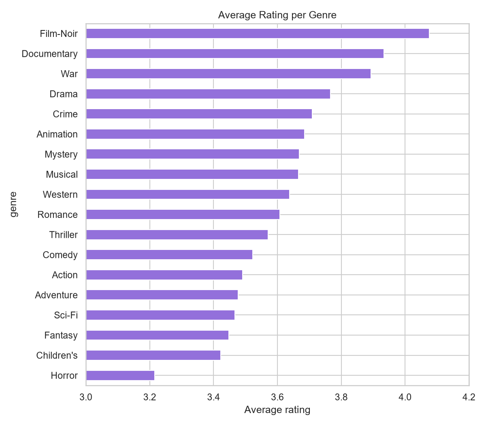
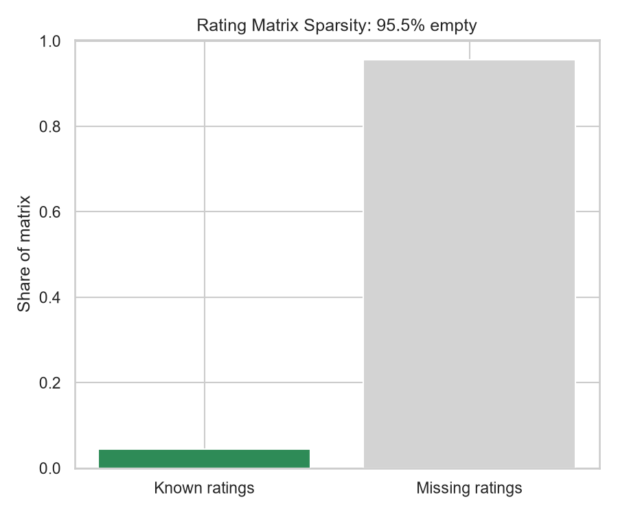

# 🎬 Movie Recommender System (MovieLens 1M)

An end-to-end recommender system built in Python: exploratory data analysis, three rating-prediction models (including **matrix factorization implemented from scratch with NumPy**), evaluation, and an interactive Streamlit app.



## Problem

Given a user's past movie ratings, predict how they would rate movies they haven't seen, and recommend movies they are likely to enjoy. The main challenge is that the data is extremely **sparse**: 95.53% of all possible user-movie ratings are missing.

## Dataset

[MovieLens 1M](https://grouplens.org/datasets/movielens/1m/) (GroupLens Research, University of Minnesota)

| Property | Value |
|---|---|
| Ratings | 1,000,209 |
| Users | 6,040 |
| Movies | 3,706 |
| Rating scale | 1 to 5 |
| Sparsity | 95.53% |
| Missing values | 0 |

## Exploratory Data Analysis

| | |
|---|---|
|  |  |
|  |  |

**Key findings**
- **Ratings are skewed toward 3 and 4.** Users mostly rate movies they expect to like, so a model must account for user and item bias.
- **The data has a long tail.** A few users and movies have thousands of ratings, while most have very few. Popular movies are well learned; rarely rated movies are hard to recommend.
- **Genre carries some signal.** Average ratings differ between genres, but not enough to build a recommender on genre alone.
- **The rating matrix is 95.53% empty.** This is the core challenge and the reason matrix factorization is used.

## Methods

All models were trained on a random 80% of the ratings and evaluated on the remaining 20% (`random_state=42`).

1. **Item Mean Baseline:** predicts each movie's average training rating.
2. **Bias Baseline:** global mean + item bias + user bias.
3. **SVD (own implementation):** matrix factorization trained with stochastic gradient descent in NumPy.
   - Prediction: `r̂(u,i) = μ + b_u + b_i + p_u · q_i`
   - 50 latent factors, 15 epochs, learning rate 0.01, L2 regularization 0.05

## Results

| Model | RMSE | MAE | Precision@10 | Recall@10 |
|---|---|---|---|---|
| Item Mean Baseline | 0.9801 | 0.7832 | 0.7670 | 0.3386 |
| Bias Baseline | 0.9093 | 0.7169 | 0.7066 | 0.3366 |
| **SVD (own implementation)** | **0.8614** | **0.6774** | 0.7522 | **0.3502** |

- SVD reduces RMSE by **12.1%** compared with the item-mean baseline, and by **5.3%** compared with the bias baseline.
- The item-mean baseline scores higher on Precision@10. In this simplified setup, each user's ranking only covers movies in their test split, and popular, highly rated movies are easy to rank correctly. SVD wins on rating accuracy (RMSE, MAE) and on Recall@10.
- Ratings were clipped to the 1 to 5 range. Relevant items are defined as true rating >= 4.

## Interactive App

The Streamlit app lets you pick a movie and returns similar movies, using cosine similarity between the learned SVD item vectors. Movies with fewer than 50 ratings are excluded to avoid unreliable results.

## How to run

```bash
# 1. Clone and install
git clone https://github.com/KashishSiddiqui/movie-recommender.git
cd movie-recommender
python -m venv venv
venv\Scripts\activate          # Windows (Mac/Linux: source venv/bin/activate)
pip install pandas numpy matplotlib seaborn streamlit

# 2. Download MovieLens 1M and put ratings.dat, movies.dat, users.dat in data/
#    https://grouplens.org/datasets/movielens/1m/

# 3. Run the pipeline
python src/eda.py              # creates the charts in results/
python src/models.py           # trains the models (about 7 minutes), saves results/metrics.csv
streamlit run app.py           # starts the app
```

## Project structure

```
movie-recommender/
├── src/
│   ├── eda.py          # exploratory data analysis and charts
│   └── models.py       # baselines + SVD from scratch + evaluation
├── results/            # charts, metrics.csv, app screenshot
├── app.py              # Streamlit app
└── README.md
```

## Limitations and future work

- **Cold start:** new users and new movies have no ratings, so the model cannot make good predictions for them. A hybrid model using movie genres and user demographics would help.
- **Popularity bias:** some recommendations (for example widely loved classics) appear for many different movies, because highly rated, heavily rated items dominate the latent space.
- **Random split:** a time-based split would be more realistic, because it avoids using future ratings to predict past ones.
- **Ranking metrics:** a full-catalog evaluation (NDCG, MAP, hit rate over all unseen movies) would measure recommendation quality better than the test-set Precision@10 used here.
- **Hyperparameters:** the number of factors, learning rate and regularization were set by hand. Cross-validated tuning would likely improve RMSE.
- **Other models:** comparing against neighborhood-based collaborative filtering and neural approaches (for example neural collaborative filtering) is a natural next step.

## Tech stack

Python, NumPy, Pandas, Matplotlib, Seaborn, Streamlit, Git

## Acknowledgements

F. Maxwell Harper and Joseph A. Konstan. 2015. *The MovieLens Datasets: History and Context.* ACM Transactions on Interactive Intelligent Systems (TiiS) 5, 4.
